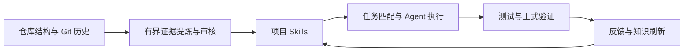

# RepoEngram

**面向代码 Agent 的仓库级工程记忆与可验证 Skills。**

[](pyproject.toml)
[](LICENSE)

RepoEngram 从仓库结构、Git 变更历史与代码证据中提炼工程知识，构建可追溯的项目 Skills。通过任务路由、按需加载与验证反馈，将仓库记忆接入代码 Agent 的执行流程。

当任务涉及项目特有的业务边界、配套修改或已有工程约定时，Agent 可以直接查询有依据的项目知识，把经验落实到实际修改中。

**0.1.1 更新：** 完善知识交付模块的职责拆分、过程追踪与历史证据提取。[查看更新记录](CHANGELOG.md)。

## 核心能力

- **证据驱动的知识提炼**：从真实代码和关联修改中提炼工作流程、约束与风险，每条知识保留来源证据。
- **任务路由与按需加载**：结合任务描述和模块范围路由 Skills，按需读取完整指令，减少无关上下文。
- **行为约束与验证绑定**：将技能行为与实际测试显式绑定，保留原有断言，输出正式验证结果。
- **快照复用与增量演进**：基线、修改反馈和增量刷新形成闭环，同一有效快照可以直接复用已审核知识。
- **标准化知识接口**：通过仓库内 Skills、CLI 和 MCP 提供知识与验证能力，Codex 可以直接查询并使用。

## 应用场景

| 场景 | RepoEngram 提供的项目知识 |
|---|---|
| 扩展业务功能与处理边界条件 | 从已有实现和历史修改中提炼业务约束、关联流程与风险提示 |
| 修改跨文件、跨模块的功能 | 提供有代码依据的工作流程，提示需要同步维护的调用方、测试和配套逻辑 |
| 接手已有项目与重复维护 | 将仓库经验整理为可查询的 Skills，支持后续任务复用与增量更新 |

## 知识生命周期

RepoEngram 把项目经验组织成 Agent 可以使用的指令，同时保留知识来源与验证依据：

- **提炼与审核**：分析仓库结构与 Git 历史，提炼并审核工作流程、约束和风险。
- **路由与检索**：结合任务描述和模块范围选择相关 Skills，按需加载指令与代码证据。
- **执行与约束**：让 Agent 依据项目知识完成实现，将技能要求绑定到实际检查。
- **验证与演进**：记录检查结果，并通过增量刷新维护可复用的项目知识。

知识准备与任务执行解耦，同一有效快照可复用已审核结果；证据提炼与知识读取采用有界上下文策略，控制输入规模。

## 快速开始

RepoEngram 通过 **项目 Skills 与 MCP 服务**接入 Agent 客户端。可在 Codex 项目会话中委托 Agent 完成部署与初始化，也可使用下方命令手动配置。接入后，Agent 可按任务检索工程知识并执行相应工作流程。

> 请为当前项目部署并初始化 RepoEngram，提炼与当前任务相关的工程知识。执行前检索相关工作流，完整读取适用 Skill，并完成实现与验证。

运行环境：Python 3.11+、Git。当前语义提炼后端使用已认证的 Codex CLI；任务执行通过客户端的 Skills 与 MCP 接口完成。详细环境配置见[安装说明](docs/installation.md)。

```bash
python -m pip install "git+https://github.com/Winterxin/RepoEngram.git@main"
repoengram --help
```

在希望增强的 Python Git 仓库中准备知识：

```bash
repoengram prepare . --task "为当前模块添加新能力，同时维护相关测试和调用方" --target codex --json
```

将结果中的 `evolution_baseline_path` 传给连接命令：

```bash
repoengram connect . --baseline <evolution_baseline_path>
```

完成配置后，在 Codex 客户端打开目标项目并新建会话，确认 `skillforge` MCP 服务已加载。Agent 可通过该服务检索工作流、读取 Skills 并验证修改。首次使用可提供以下执行指令：

> 修改前先查询 SkillForge 项目知识，完整读取适用 Skill。按技能要求完成修改和测试，并在完成后调用 verify_patch 检查结果。

[完整安装说明](docs/installation.md)包含可直接使用的 PowerShell 示例和 Claude Code 接入方式。

## 架构概览



## 测试与评测

项目通过离线回归检查知识提炼、Skill 渲染与交付、任务路由、MCP 接口和验证反馈。0.1.1 版本完成 267 项回归检查。

- [发布验证结果](docs/release-checks.json)：测试范围、执行结果与安装包构建记录。
- [源码与测试清单](docs/release-provenance.json)：版本来源与逐文件源码哈希。
- [任务评测记录](docs/evaluation-checkpoint-20261017.json)：逐任务分数、历史对照与执行信息。

## 本地开发

```bash
git clone https://github.com/Winterxin/RepoEngram.git
cd RepoEngram
python -m pip install -e ".[dev]"
python -m pytest
```

默认测试集合覆盖 Skill 渲染与同步、任务路由、知识读取、MCP、历史证据提取、原测试保护及序列化恢复。源码来源和测试范围见[发布清单](docs/release-provenance.json)。

## License

[MIT](LICENSE)
